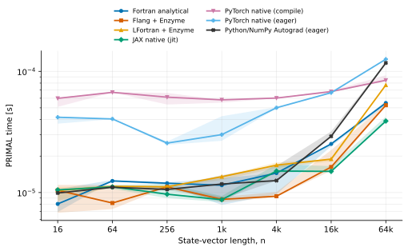

# Differentiable Fortran

A side-by-side comparison of ways to differentiate a Fortran model and call it from
Python. It is meant for people deciding which derivative engine and interface to
use for their own Fortran code.

Every implementation advances the same one-dimensional heat equation by one time
step. The repository keeps the mathematics, inputs, outputs, validation cases, and
benchmark protocol fixed. You can therefore compare derivative engines and Python
interfaces without also changing the problem.

## Pick a solution

| You need | Start here | What stays in the hot path |
|---|---|---|
| A Fortran application with generated derivatives | [Flang + Enzyme](solutions/flang-enzyme) | Fortran compiled by Flang, Enzyme-generated derivative |
| The same pipeline with LFortran | [LFortran + Enzyme](solutions/lfortran-enzyme) | Fortran compiled by LFortran, Enzyme-generated derivative |
| A readable correctness and performance reference | [Analytical Fortran](solutions/analytic-fortran) | Hand-derived Fortran JVP or VJP |
| A modern object-oriented Fortran API in Python | [f90wrap](solutions/f90wrap) | f90wrap exposes the derived type and type-bound procedures |
| A small procedural Fortran API in Python | [ISO C + ctypes](solutions/iso-c-ctypes) | ISO C ABI called through `ctypes` |
| Lower Python call overhead or a custom adapter | [Cython](solutions/cython) | Compiled Cython-to-C/Fortran call |
| A callback used repeatedly inside SciPy | [SciPy LowLevelCallable](solutions/scipy-lowlevel) | SciPy calls the Fortran function pointer directly |
| Element-wise calls from NumPy | [NumPy ufunc](solutions/numpy-ufunc) | A compiled NumPy ufunc loop |
| A compiled JAX program that calls Fortran | [JAX FFI](solutions/jax-ffi) | XLA FFI handler calls the compiled Fortran library |
| A compiled PyTorch program that calls Fortran | [PyTorch custom operator](solutions/pytorch-custom-op) | Registered native operator calls Fortran |
| A service or portable model component | [Tesseract](solutions/tesseract) | Tesseract packages and orchestrates the selected implementation |
| A Python-native baseline | [JAX](solutions/jax-native) or [PyTorch](solutions/pytorch-native) | JAX or PyTorch primitive operations |
| Eager Python/NumPy automatic differentiation | [Autograd](solutions/autograd-native) | Python tracing and NumPy operations on every call |

A plain `ctypes` call crosses Python on every call; in a SciPy `LowLevelCallable`,
`ctypes` is used only once to obtain the function address. Cython, NumPy ufuncs,
JAX FFI and PyTorch custom operators address the same call-overhead problem in
different ways. Tesseract is one integration target among others, useful when the
chosen implementation must be packaged or served.

## What is compared

- Derivative engines: analytical Fortran JVP and VJP, Enzyme applied to LLVM IR
  from Flang and from LFortran, native JAX and PyTorch, and eager Autograd.
- Interfaces: ISO C with `ctypes`, f90wrap for an object-oriented Fortran API,
  Cython, SciPy `LowLevelCallable`, a NumPy ufunc, `jax.ffi`, a PyTorch custom
  operator and Tesseract.
- Measurements: primal, JVP and VJP scaling with problem size, first-call
  (compilation) cost, single-call interface latency, and derivative accuracy
  against the analytical formulas, finite differences and the adjoint identity.

## How to use it

1. Read [the common contract](docs/contract.md): the primal, analytical JVP and
   analytical VJP that every solution implements.
2. Pick a path from the table above or the [decision guide](docs/decision-guide.md).
3. Follow that solution's README; each solution builds independently.
4. Read [the benchmark method](docs/benchmark-method.md) before comparing timings.
   The committed [reference results](docs/benchmark-results.md) come from one
   machine and will differ on others.

## Build and test

The common Fortran reference needs CMake, Ninja and a Fortran compiler:

```console
cmake -S . -B build -G Ninja
cmake --build build
ctest --test-dir build --output-on-failure
```

The Python tests and benchmarks use [uv](https://docs.astral.sh/uv/):

```console
uv sync --extra test --extra benchmark --extra wrappers --extra jax
uv run pytest -q
```

The Enzyme solutions require matching LLVM, compiler and Enzyme versions; see
[the toolchain notes](docs/toolchains.md). Regenerate all reference data and
figures with `benchmark/reproduce-reference.sh`.



## Documentation

- [Common contract](docs/contract.md)
- [Decision guide](docs/decision-guide.md) and [solution matrix](docs/solutions.md)
- [Benchmark method](docs/benchmark-method.md) and
  [reference results](docs/benchmark-results.md)
- [Toolchains](docs/toolchains.md)
- [Limitations](docs/limitations.md)
- [Enzyme workload study](studies/enzyme-readme): seven workload families (LSTM,
  BA, GMM, Euler, RK4, FFT, Brusselator) in C++/Enzyme, Fortran with Flang/Enzyme
  and LFortran/Enzyme, and JAX

## License

Apache-2.0. Dependencies retain their own licenses; see
[THIRD_PARTY.md](THIRD_PARTY.md). Files adapted from Apache-2.0 examples carry the
required attribution in [NOTICE](NOTICE).
