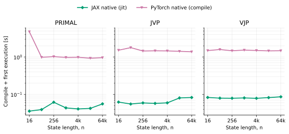
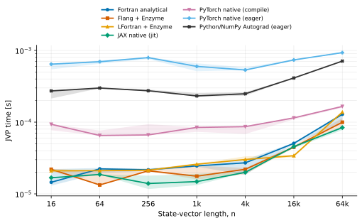
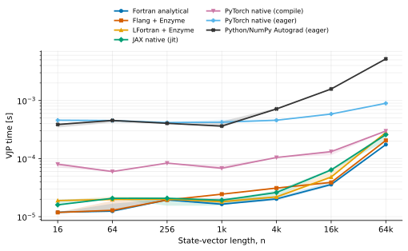
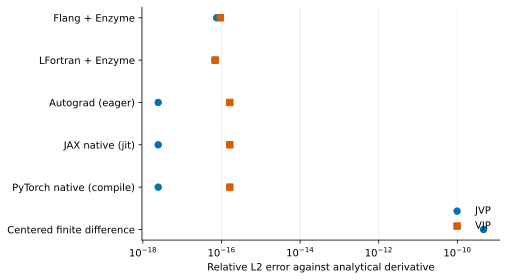
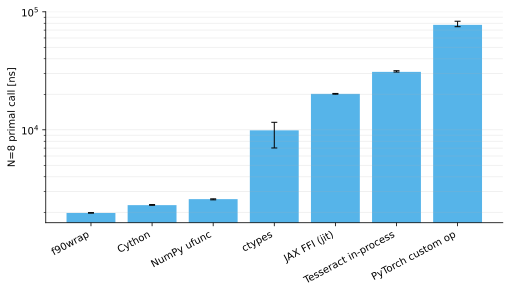

# Reference benchmark results

Reference figures are generated from the raw files in
[`benchmark/results/reference`](../benchmark/results/reference) and committed under
[`benchmark/figures`](../benchmark/figures). They were collected on a consumer
x86-64 workstation
with Flang 22.1.6, LFortran `0.58.0-4615-g2d1afed24`, Enzyme for LLVM 22,
Autograd 1.9.1, JAX 0.10.2, and PyTorch 2.13.0. See
[the machine-readable manifest](../benchmark/results/reference/manifest.json) and
[benchmark method](benchmark-method.md) before comparing the values with
another machine.


At `n=65,536`, median primal times were 54.83 µs for analytical Fortran,
52.54 µs for Flang Enzyme, 77.10 µs for LFortran Enzyme, 38.90 µs for JAX JIT,
84.45 µs for compiled PyTorch, 125.96 µs for eager PyTorch, and 117.32 µs for
eager Python/NumPy Autograd. The JVP and VJP figures retain the analytical
derivative as a timed implementation rather than using it only for validation.

Compilation is excluded from those steady-state values. The separate startup
plot records compile plus first execution after clearing the relevant cache. At
`n=65,536`, JAX took 0.056, 0.083, and 0.086 seconds for the primal, JVP, and VJP;
PyTorch Inductor took 0.965, 1.383, and 1.477 seconds.

On this run, compiled PyTorch amortized its startup cost relative to eager
PyTorch after roughly 23,000 primal calls, 1,800 JVP calls, or 2,500 VJP calls at
this size. The break-even point follows directly from the committed startup and
steady-state measurements and will change with the model and machine.







At `n=65,536`, eager Python/NumPy Autograd took 5.20 ms for the VJP, compared
with 0.175 ms for analytical Fortran, 0.258 ms for JAX JIT, and 0.299 ms for
compiled PyTorch. This eager series includes tracing and tape construction on
every derivative call.

The generated and framework derivatives agree with the analytical formulas near
binary64 rounding error. The centered finite-difference JVP is about six orders of
magnitude less accurate in this case.



The interface plot measures one `n=8` primal call. f90wrap reuses its output array;
Cython, the ufunc, and `ctypes` allocate outputs. JAX reuses device inputs, and
PyTorch reuses tensor inputs. Those policies are recorded in the raw timing table.



Reproduce all data and figures with:

```console
benchmark/reproduce-reference.sh
```

